# SmartCart Pro — Complete Project Audit & Step-by-Step Implementation Task Report

**Document Version:** 1.0.0  
**Audit Date:** October 17, 2026  
**Auditor:** Senior Software Architect, ASP.NET Core & Database Review Team  
**Target Solution:** `SmartCartPro` (`SmartCartPro.sln` / `SmartCartPro.csproj`)  
**Scope Notice:** This audit strictly evaluates **SmartCart Pro**. Legacy and alternative repositories (`Ecommerce`, `platform/src`) are explicitly excluded per user specification.

---

## Table of Contents

1. [Section 1 — Executive Summary](#section-1--executive-summary)
2. [Section 2 — Existing Architecture](#section-2--existing-architecture)
3. [Section 3 — Module Status Matrix](#section-3--module-status-matrix)
4. [Section 4 — Complete Step-by-Step Task List](#section-4--complete-step-by-step-task-list)
5. [Section 5 — Super Admin Task Sequence](#section-5--super-admin-task-sequence)
6. [Section 6 — Company Admin Task Sequence](#section-6--company-admin-task-sequence)
7. [Section 7 — Security and Data Integrity Tasks](#section-7--security-and-data-integrity-tasks)
8. [Section 8 — UI/UX Fixes and Design Review](#section-8--uiux-fixes-and-design-review)
9. [Section 9 — Comprehensive Manual Testing Plan](#section-9--comprehensive-manual-testing-plan)
10. [Section 10 — Recommended Execution Roadmap](#section-10--recommended-execution-roadmap)
11. [Section 11 — Immediate Next Task](#section-11--immediate-next-task)

---

## Section 1 — Executive Summary

### 1.1 Current Project Structure
The `SmartCartPro` project is an **ASP.NET Core 9.0 MVC Web Application** designed with a PostgreSQL database backend. It combines server-rendered Razor Views with the modern **Metis v1.0.0 Admin UI** template (`wwwroot/metis`, `wwwroot/css/admin-shell.css`, `wwwroot/js/admin-sidebar.js`). The solution consists of a single web project (`SmartCartPro.csproj`) organized into modular directories:
- `Controllers/` — MVC & Web API Controllers
- `Entities/` — EF Core domain entities
- `Data/` — EF Core DbContext (`SmartCartDbContext`)
- `Repositories/` & `Services/` — Data access and business service layers
- `Dapper/` — Raw SQL performance queries for justified reporting
- `Database-Postgres/` — 43 idempotent table DDL scripts, 5 seed scripts, 4 patch migrations, and automated build/patch batch files (`BuildDatabase.bat`, `ApplyPatches.bat`)
- `Views/` — Razor Views organized by functional domain (`Admin`, `Auth`, `Catalog`, `Customers`, `Home`, `Inventory`, `Reports`, `Sales`, `Shared`)

### 1.2 Current Implementation Status
The project exhibits an **advanced foundational skeleton** with strong database DDL design and partial authentication/super-admin services, but possesses a **massive gap between database design, backend services, and user interface**:
1. **Database Schema:** **~95% Complete**. 43 PostgreSQL tables covering multi-tenancy, platform administration, inventory, purchasing, POS, sales, returns, and customers are already defined and script-ordered.
2. **Super Admin Module:** **~45% Complete**. The backend service (`SuperAdminService`), repository (`SuperAdminRepository`), models (`SuperAdminModels`), and controller (`SuperAdminController`) are built. However, **ZERO Razor Views exist in `Views/SuperAdmin/`**, meaning any request to `/SuperAdmin/*` crashes immediately with a view-not-found exception. Furthermore, the Company Admin invitation acceptance endpoint is missing.
3. **Company Admin Inventory Modules:** **~10% Complete**. While controllers (`CatalogController`, `InventoryController`, `SalesController`, `AdminController`, `CustomersController`, `ReportsController`) and Razor Views exist, **all company admin views are static HTML mockups rendering hardcoded table rows**. Basic services exist only for Products and Categories, but even these are not connected to the controllers. More than 25 database tables are unmapped in EF Core.

### 1.3 Main Missing Functionality
- **Super Admin UI Views:** Missing all 12 views (`Dashboard.cshtml`, `Step1.cshtml` through `Step7.cshtml`, `Review.cshtml`, `License.cshtml`, `EditLicense.cshtml`, `AuditLog.cshtml`).
- **Company Admin Onboarding Acceptance:** Missing `/Auth/AcceptInvitation` GET and POST actions, token verification, and password creation view.
- **Entity Mappings:** 26 database tables are completely unmapped in `SmartCartDbContext` (including `suppliers`, `purchases`, `purchase_details`, `sales`, `sale_details`, `payments`, `product_variants`, `units`, `taxes`, `brands`, `stock_movements`, `cash_sessions`, `sales_returns`).
- **Service & Repository Layer:** Missing repository and service implementations for Inventory, Suppliers, Purchases, POS Billing, Invoicing, Customers, Stores, Employees, and Roles.
- **POS & Billing Engine:** Missing live cart calculations, barcode scanning, stock validation, checkout transaction boundary, cash session management, invoice sequence generation, and stock deduction.
- **Stock Movement & Audit Trail:** Missing automatic transactional stock deduction on sales and stock addition on goods receipt.
- **License & Module Enforcement:** No action filter or middleware enforces license validity or restricted module access on company-level routes.

### 1.4 Critical Architectural & Security Issues
1. **Hardcoded Super Admin OTP Bypass:** `AuthService.cs` contains a hardcoded OTP (`var otp = "123456"`) and bypass check (`string.Equals(input.Code.Trim(), "123456")`), allowing anyone with the Super Admin password to bypass two-factor authentication.
2. **Role Naming Collision:** The database seed script (`001_DefaultRoles.sql`) names the company-level administrator role `SUPER_ADMIN`, creating ambiguity with the platform Super Admin (`is_platform_super_admin = TRUE`).
3. **Platform Identity Exposure:** `Views/Admin/Employees.cshtml` and `Views/Admin/Roles.cshtml` display "Super Admin" and "SUPER_ADMIN" in tenant screens. Future database queries must enforce platform user filtering.
4. **Missing Post-Login Routing:** Platform Super Admins logging in without a `returnUrl` are redirected to `/Home/Index` (Store Dashboard) instead of `/SuperAdmin/Dashboard`.
5. **Missing Seed Execution in `BuildDatabase.bat`:** Script `005_ModulePresets.sql` is omitted from the batch script execution loop, leaving presets empty during automated initialization.

### 1.5 Recommended Implementation Order
1. **Phase 1: Security, Super Admin Views & Onboarding Completion** — Repair security bypasses, build the missing Super Admin Razor views, enable Company Admin invitation completion, and fix onboarding database seeding.
2. **Phase 2: Core Domain Mappings & Product Catalog** — Map missing EF Core entities, connect Categories, Subcategories, Brands, Units, Taxes, and Product CRUD with dynamic views.
3. **Phase 3: Variants, SKU & Inventory Balances** — Map `product_variants`, establish store-scoped inventory tracking, stock adjustments, and stock movement audit trails.
4. **Phase 4: Procurement & Suppliers** — Implement Supplier management, purchase orders, goods receipt workflows, and automated stock replenishment.
5. **Phase 5: POS Billing, Invoicing & Sales** — Build the live POS checkout interface, barcode/SKU search, payment processing, transactional stock deduction, invoice printing, and sales history.
6. **Phase 6: Store, Employee, Role & Customer Management** — Complete dynamic multi-store configuration, employee assignment, role permissions, customer directory, and system settings.
7. **Phase 7: License & Module Access Enforcement, Hardening & QA** — Implement license restriction filters, module access enforcement, Dapper analytics reporting, and end-to-end regression validation.

---

## Section 2 — Existing Architecture

### 2.1 Project Responsibility Breakdown
`SmartCartPro` follows a layered monolithic architecture within an ASP.NET Core 9.0 Web Application:
- **Presentation Layer (MVC):** Server-rendered Razor Pages using standard Model-View-Controller architecture. Static web assets are served from `wwwroot/` with Metis modern build bundles (`wwwroot/metis/assets/`).
- **API Endpoints:** Web API controllers (such as `FilterController`) expose JSON endpoints for client-side dropdown fills and asynchronous lookups.
- **Service Layer (`Services/`):** Encapsulates business validation, transaction coordination, hashing, JWT token creation, and email notifications (`AuthService`, `SuperAdminService`, `CategoryService`, `ProductService`, `FilterService`, `OrderService`, `SmtpEmailService`).
- **Data Access Layer (`Repositories/` & `Data/`):** `SmartCartDbContext` provides Object-Relational Mapping (ORM) using Npgsql and EF Core 9. Repositories abstract entity manipulation and database queries.
- **Reporting Query Layer (`Dapper/`):** High-performance read-only queries utilizing Dapper (`ProductReportRepository`) for aggregate calculations without EF Core overhead.
- **Configuration & Middleware (`Configuration/`, `Middleware/`, `Extensions/`):** Strong-typed options (`JwtSettings`, `EnvironmentSettings`, `SmtpSettings`, `OtpSettings`), unified error handling (`AppExceptionHandler`, `ExceptionErrorMapper`), and dependency injection extensions.

### 2.2 Database Management Strategy
- **Isolation Model:** **Database-per-Client Installation** (Single Tenant per Database). Each client deployment runs on its own database instance (`smartcart_pro`). Inside this database, one primary `company` record exists, which owns one or more `store` records.
- **Migration Policy:** **Zero EF Core Migrations**. Entity Framework Core Migrations (`Add-Migration`, `Update-Database`) are strictly forbidden. The source of truth is raw SQL scripts located in `Database-Postgres/`.
- **Script Management:**
  - `Database-Postgres/01_Tables/create.sql` runs 43 table scripts in strict dependency order.
  - `Database-Postgres/02_Seed/` populates default roles, permissions, settings, super admin credentials, and module presets.
  - `Database-Postgres/03_Patches/` applies incremental schema patches (`V001` through `V004`) tracked in `patch_history`.
  - Batch scripts `BuildDatabase.bat` and `ApplyPatches.bat` execute via `psql`.

### 2.3 Authentication and Authorization Architecture
- **Authentication Scheme:** `JwtBearerDefaults.AuthenticationScheme` utilizing JSON Web Tokens stored in an `HttpOnly`, `SameSite=Lax`, secure cookie (`smartcartpro.auth.token`).
- **Token Handling:** Configured in `Program.cs` via `JwtBearerEvents.OnMessageReceived` (extracts token from cookie) and `OnChallenge` (redirects unauthenticated HTML requests to `/Auth/Login?returnUrl=...`).
- **Claims Architecture (`Helpers/AuthClaims.cs`):**
  - `id_user` — User primary key.
  - `fk_store` — Active store ID (0 for platform Super Admin).
  - `fk_company` — Active company ID (0 for platform Super Admin).
  - `store_code` / `store_name` — Display details of active store.
  - `is_platform_super_admin` — Flag (`"1"` or `"0"`).
  - `must_change_password` — Enforces initial password update.
- **Authorization Policies:**
  - `PlatformSuperAdmin` policy requires `is_platform_super_admin = "1"`. Applied to `SuperAdminController`.
  - Default global policy requires authenticated user across all MVC routes via `AuthorizeFilter`.

### 2.4 Frontend UI & Asset Architecture
- **UI Framework:** Metis v1.0.0 Admin Template (modern Bootstrap 5 derivative, compiled into `wwwroot/metis`).
- **Shell Styling:** `wwwroot/css/admin-shell.css` provides responsive full-height layout, custom scroll containers, and desktop/mobile sidebar states.
- **Shell Scripting:** `wwwroot/js/admin-sidebar.js` provides persistent collapsible desktop sidebar state via `localStorage` (`sidebar-collapsed`) and mobile overlay drawer navigation.
- **Layout Templates:**
  - `_Layout.cshtml` — Main layout for Store Managers, Cashiers, and Company Admins.
  - `_SuperAdminLayout.cshtml` — Specialized layout with Super Admin branding, wizard navigation, and management links.
  - `_AuthLayout.cshtml` — Centered, distraction-free authentication layout.
- **Scope Rule:** The existing default theme is strictly maintained. Multiple theme engines, theme customizers, and runtime theme switchers are excluded from current implementation scope.

---

## Section 3 — Module Status Matrix

| Module | Current Status | Evidence in Existing Code | Missing Work | Priority |
|---|---|---|---|---|
| **Super Admin Auth & Security** | Partially Implemented | `users.is_platform_super_admin`, `AuthService.BeginPlatformOtpAsync`, `SmartCartPolicies` in `ServiceCollectionExtensions.cs`. | Remove hardcoded OTP `"123456"`, fix redirect to `/SuperAdmin/Dashboard` upon login, prevent Super Admin display in tenant views. | P0 (Critical) |
| **Super Admin Dashboard** | Partially Implemented | `SuperAdminController.Dashboard`, `SuperAdminService.GetDashboardAsync`, `_SuperAdminLayout.cshtml`. | Razor View `Views/SuperAdmin/Dashboard.cshtml` is missing. | P0 (Critical) |
| **Company Registration Wizard (Steps 1–6)** | Partially Implemented | `SuperAdminController.cs` (Steps 1–6), `SuperAdminService.cs`, `001_Company.sql`, `002_Store.sql`, `V004__LicenseAndInstallation.sql`. | Razor Views for Steps 1, 2, 3, 5, 6 are completely missing; Step 4 (Theme) must be bypassed/simplified per scope. | P0 (Critical) |
| **Company Admin Provisioning (Step 7)** | Partially Implemented | `SuperAdminService.SaveStep7Async`, `user_invitations` table, `SmtpEmailService.cs`. | Step 7 Razor View missing; `/Auth/AcceptInvitation` GET & POST actions and view missing. | P0 (Critical) |
| **Super Admin Review & Activation** | Partially Implemented | `SuperAdminController.Review`, `SuperAdminController.Activate`, `SuperAdminService.ActivateAsync`. | Razor View `Views/SuperAdmin/Review.cshtml` is missing. | P0 (Critical) |
| **License Management** | Partially Implemented | `license` table, `SuperAdminService.UpdateLicenseAsync`, `SuspendLicenseAsync`, `ReactivateLicenseAsync`. | Razor Views `License.cshtml` & `EditLicense.cshtml` missing; runtime license expiration/suspension filter missing. | P1 (High) |
| **Super Admin Audit Logs** | Partially Implemented | `audit_logs` table, `SuperAdminService.GetAuditLogsAsync`, `SuperAdminModels.AuditLogListViewModel`. | Razor View `Views/SuperAdmin/AuditLog.cshtml` is missing. | P2 (Medium) |
| **Database Build & Seed Scripts** | Partially Implemented | `BuildDatabase.bat`, `01_Tables/create.sql`, `02_Seed/*.sql`. | `005_ModulePresets.sql` is missing from `BuildDatabase.bat` execution loop; company admin role naming collision. | P0 (Critical) |
| **Tenant Store Management** | Partially Implemented | `002_Store.sql`, `user_store_access` table, `AdminController.Stores`. | `Stores.cshtml` is static HTML; missing EF Core repository, service, store CRUD, and store switcher UI. | P1 (High) |
| **Employee & User Management** | Partially Implemented | `003_Users.sql`, `user_roles`, `user_store_access`, `AdminController.Employees`. | `Employees.cshtml` is static HTML; missing Employee entity/DTOs, repository, service, CRUD, and password reset. | P1 (High) |
| **Roles & Permissions Management** | Partially Implemented | `roles`, `permissions`, `role_permissions` tables, `AdminController.Roles`. | `Roles.cshtml` is static HTML; missing repository, service, role CRUD, and permission matrix checkboxes. | P2 (Medium) |
| **Product Categories** | Partially Implemented | `categories` table, `Category.cs`, `CategoryRepository.cs`, `CategoryService.cs`, `CatalogController.Categories`. | `Categories.cshtml` is static HTML; `CatalogController` does not inject `ICategoryService`; missing Create/Edit/Delete actions. | P1 (High) |
| **Product Subcategories** | Missing | `subcategories` table (013_SubCategories.sql), `SubCategory.cs` entity. | Missing repository, service, controller actions, and view. | P1 (High) |
| **Brands Management** | Partially Implemented | `014_Brands.sql`, `CatalogController.Brands()`. | Missing EF entity, repository, service, CRUD actions; `Brands.cshtml` is static HTML. | P2 (Medium) |
| **Units & Taxes Configuration** | Missing | `010_Units.sql`, `011_Taxes.sql`. | Missing EF entities, repository, service, management UI in Admin/Settings. | P2 (Medium) |
| **Product Management** | Partially Implemented | `products` table, `Product.cs`, `ProductRepository.cs`, `ProductService.cs`, `CatalogController.Products`. | `Products.cshtml` is static HTML; `CatalogController` does not inject `IProductService`; missing Add/Edit forms and validation. | P1 (High) |
| **Product Variants & SKU** | Partially Implemented | `016_ProductVariants.sql`, `CatalogController.Variants()`. | `product_variants` not mapped in EF Core; missing repository, service, SKU generator, and dynamic view. | P1 (High) |
| **Store Inventory & Stock** | Partially Implemented | `inventory` table, `Inventory.cs`, `InventoryController.Stock`. | `Stock.cshtml` is static HTML; missing `IInventoryRepository`, `IInventoryService`, stock adjustment form, low-stock filter. | P1 (High) |
| **Stock Movements Audit** | Missing | `022_StockMovements.sql`. | Missing EF entity, repository, automated transaction triggers on sale/purchase/adjustment, and movement history view. | P1 (High) |
| **Suppliers Management** | Partially Implemented | `018_Suppliers.sql`, `InventoryController.Suppliers`. | `Suppliers.cshtml` is static HTML; missing EF entity, repository, service, and CRUD modal/actions. | P2 (Medium) |
| **Purchasing & Goods Receipt** | Partially Implemented | `023_Purchases.sql`, `024_PurchaseDetails.sql`, `InventoryController.Purchases`. | `Purchases.cshtml` is static HTML; missing EF entities, purchase order service, line item entry, and stock increment logic. | P1 (High) |
| **POS Billing Interface** | Partially Implemented | `SalesController.Pos()`, `Views/Sales/Pos.cshtml`. | `Pos.cshtml` is static HTML; missing live cart JavaScript, barcode scanner lookup API, tax calculation, and hold bill state. | P1 (High) |
| **Cash Sessions Management** | Missing | `027_CashSessions.sql`. | Missing EF entity, repository, service, POS session open/close modals, float tracking, and variance calculation. | P1 (High) |
| **Sales Invoicing & Payment** | Partially Implemented | `025_Sales.sql`, `026_SaleDetails.sql`, `028_Payments.sql`, `SalesController.Invoices`. | `Invoices.cshtml` is static HTML; missing checkout transaction service, invoice sequence generator, payment recording. | P1 (High) |
| **Sales Returns & Refunds** | Partially Implemented | `029_SalesReturns.sql`, `030_SalesReturnDetails.sql`, `SalesController.Returns`. | `Returns.cshtml` is static HTML; missing return line selection, restock inventory logic, and refund recording. | P2 (Medium) |
| **Customer Management** | Partially Implemented | `019_Customers.sql`, `020_CustomerAddresses.sql`, `CustomersController.Index`. | `Customers/Index.cshtml` is static HTML; missing EF entities, repository, service, and customer lookup API for POS. | P2 (Medium) |
| **Reports & Analytics** | Partially Implemented | `ReportsController.cs`, `ProductReportRepository.cs` (Dapper). | Views are static HTML; Dapper queries uninvoked; missing Sales, Product, and Inventory summary endpoints. | P2 (Medium) |
| **Company Admin Dashboard** | Partially Implemented | `HomeController.Index()`, `Views/Home/Index.cshtml`. | View renders hardcoded sample values; missing dashboard service to aggregate real sales, low stock, and invoice counts. | P2 (Medium) |
| **Company Settings** | Partially Implemented | `032_Settings.sql`, `AdminController.Settings`. | `Settings.cshtml` is static HTML; missing key-value settings service for receipt templates, currency, and defaults. | P3 (Low) |

---

## Section 4 — Complete Step-by-Step Task List

### Task SA-001: Fix Super Admin Security Vulnerabilities, Seed Batch Script & Default Route

- **Priority:** P0 Critical
- **Current state:** `AuthService.cs` has hardcoded OTP `"123456"` (lines 104, 236). `BuildDatabase.bat` omits `02_Seed\005_ModulePresets.sql`. Super Admin login without `returnUrl` redirects to `Home/Index` instead of `SuperAdmin/Dashboard`.
- **Objective:** Eliminate the security bypass in OTP generation and verification, ensure module presets are seeded during database builds, and correctly direct Super Admin to `/SuperAdmin/Dashboard` upon authentication.
- **Scope:** `AuthService.cs`, `AuthController.cs`, `BuildDatabase.bat`.
- **Files to inspect:**
  - `SmartCartPro/Services/AuthService.cs`
  - `SmartCartPro/Controllers/AuthController.cs`
  - `SmartCartPro/Database-Postgres/BuildDatabase.bat`
  - `SmartCartPro/Database-Postgres/02_Seed/005_ModulePresets.sql`
- **Expected file changes:**
  - `SmartCartPro/Services/AuthService.cs` (generate real numeric OTP via `GenerateNumericOtp`, remove hardcoded `"123456"` bypass).
  - `SmartCartPro/Controllers/AuthController.cs` (in `RedirectToLocal`, check `result.IsPlatformSuperAdmin` or user claims; if true and no explicit returnUrl, redirect to `SuperAdmin/Dashboard`).
  - `SmartCartPro/Database-Postgres/BuildDatabase.bat` (add `"02_Seed\005_ModulePresets.sql"` to the seed script loop).
- **Database changes:** None required (execute `005_ModulePresets.sql` via updated batch script).
- **Implementation steps:**
  1. In `AuthService.cs`: replace `var otp = "123456";` with `var otp = GenerateNumericOtp(_otpSettings.Length);`.
  2. In `AuthService.cs`: remove `var isStaticOtp = string.Equals(input.Code.Trim(), "123456"...);` and verify solely against `challenge.OtpHash`.
  3. In `AuthController.cs`: update `Login` POST and `VerifyOtp` POST to inspect `result.IsPlatformSuperAdmin`; redirect to `Url.Action("Dashboard", "SuperAdmin")` if true and `returnUrl` is empty or `/`.
  4. In `BuildDatabase.bat`: append `"02_Seed\005_ModulePresets.sql"` to the `for %%F in (...)` block.
- **Dependencies:** None.
- **Acceptance criteria:**
  - Super Admin login generates a cryptographically random 6-digit OTP sent via email.
  - Entering `"123456"` fails verification unless that was the actual generated OTP.
  - Successful Super Admin OTP verification redirects directly to `/SuperAdmin/Dashboard`.
  - Running `BuildDatabase.bat` successfully inserts Basic and Premium presets into `module_presets`.
- **Manual test cases:**
  1. Sign in as `Muhdfarismp@gmail.com` with `Admin@123`.
  2. Attempt OTP `"123456"` when a different code was emailed. Confirm verification fails.
  3. Enter the emailed code. Confirm redirection to `/SuperAdmin/Dashboard`.
  4. Inspect database table `module_presets` to confirm 2 rows exist.
- **Git checkpoint:** `fix(security): resolve superadmin otp bypass and preset seed loop`
- **Out of scope:** Redesigning SMS OTP or adding multi-factor authenticators.

---

### Task SA-002: Create Super Admin Dashboard View

- **Priority:** P0 Critical
- **Current state:** `SuperAdminController.Dashboard()` returns `View(vm)` with `SuperAdminDashboardViewModel`, but `Views/SuperAdmin/Dashboard.cshtml` does not exist. Navigating to `/SuperAdmin/Dashboard` throws a 500 View Not Found exception.
- **Objective:** Create `Views/SuperAdmin/Dashboard.cshtml` implementing the dashboard layout, KPI stat cards, onboarding alert banners, license status warnings, and recent audit activity table.
- **Scope:** `Views/SuperAdmin/Dashboard.cshtml`.
- **Files to inspect:**
  - `SmartCartPro/Controllers/SuperAdminController.cs` (lines 31–35)
  - `SmartCartPro/Models/SuperAdminModels.cs` (`SuperAdminDashboardViewModel`)
  - `SmartCartPro/Views/Shared/_SuperAdminLayout.cshtml`
- **Expected file changes:**
  - `SmartCartPro/Views/SuperAdmin/Dashboard.cshtml` (new file)
- **Database changes:** None.
- **Implementation steps:**
  1. Create directory `SmartCartPro/Views/SuperAdmin` if it does not exist.
  2. Create `Dashboard.cshtml` declaring `@model SmartCartPro.Models.SuperAdminDashboardViewModel` and `Layout = "_SuperAdminLayout"`.
  3. Render onboarding status banner: if `!Model.OnboardingComplete`, render an actionable alert linking to `/SuperAdmin/Step{Model.OnboardingStep + 1}`.
  4. Render KPI stat cards: Company Name, License Status, Current Stores / Max Stores, Enabled Modules Count, Admin Provisioned badge.
  5. Render license warnings for Near Expiry (<= 30 days), Expired, or Suspended states.
  6. Render `RecentActivity` table displaying `CreatedAt`, `ActorName`, `EntityName`, `Action`, and `Details`.
- **Dependencies:** SA-001.
- **Acceptance criteria:**
  - Navigating to `/SuperAdmin/Dashboard` renders with HTTP 200 using `_SuperAdminLayout.cshtml`.
  - Displayed stats match `InstallationConfig`, `Company`, `License`, and `AuditLogs` in the database.
  - Incomplete onboarding shows a direct "Continue Setup Wizard" button.
- **Manual test cases:**
  1. Navigate to `/SuperAdmin/Dashboard` after signing in.
  2. Verify no 500 error occurs and header shows "Platform Super Admin".
  3. Confirm warning banners display when onboarding is incomplete or license is near expiry.
- **Git checkpoint:** `feat(superadmin): add dashboard razor view`
- **Out of scope:** Adding live SignalR refresh to dashboard KPIs.

---

### Task SA-003: Implement Company Registration Wizard Views (Steps 1, 2, 3)

- **Priority:** P0 Critical
- **Current state:** `SuperAdminController` contains `Step1` (Company Profile), `Step2` (Regional Settings), and `Step3` (Module Selection), but their corresponding views in `Views/SuperAdmin/` are missing.
- **Objective:** Create `Step1.cshtml`, `Step2.cshtml`, and `Step3.cshtml` with Bootstrap 5 form validation, wizard step indicators, preset selection buttons, and module checkboxes.
- **Scope:** `Views/SuperAdmin/Step1.cshtml`, `Step2.cshtml`, `Step3.cshtml`.
- **Files to inspect:**
  - `SmartCartPro/Controllers/SuperAdminController.cs` (lines 37–96)
  - `SmartCartPro/Models/SuperAdminModels.cs` (`WizardStep1Model`, `WizardStep2Model`, `WizardStep3Model`)
  - `SmartCartPro/Views/Shared/_SuperAdminLayout.cshtml` (wizard progress styling)
- **Expected file changes:**
  - `SmartCartPro/Views/SuperAdmin/Step1.cshtml` (new file)
  - `SmartCartPro/Views/SuperAdmin/Step2.cshtml` (new file)
  - `SmartCartPro/Views/SuperAdmin/Step3.cshtml` (new file)
- **Database changes:** None.
- **Implementation steps:**
  1. Create `Views/SuperAdmin/Step1.cshtml`: wizard progress bar (Step 1 active), Company Name, Company Code, Legal Name, Tax Number, Email, Phone, Address, Next button (`POST /SuperAdmin/Step1`).
  2. Create `Views/SuperAdmin/Step2.cshtml`: Currency Code (default INR), Time Zone (dropdown/list, default Asia/Kolkata), Locale (default en-IN), Next button (`POST /SuperAdmin/Step2`).
  3. Create `Views/SuperAdmin/Step3.cshtml`: Module Presets (Basic vs Premium buttons), Module Checkbox grid bound to `SelectedModuleIds`, Next button (`POST /SuperAdmin/Step3`). Add client script to auto-select checkboxes when Basic or Premium preset button is clicked.
  4. Ensure all forms include `@Html.AntiForgeryToken()` and validation summary partials.
- **Dependencies:** SA-001, SA-002.
- **Acceptance criteria:**
  - Super Admin can complete Step 1: validates required fields, writes to `company` table, and redirects to Step 2.
  - Super Admin can complete Step 2: updates company currency/timezone, redirects to Step 3.
  - Super Admin can complete Step 3: clicking "Basic" selects the 4 basic modules; clicking "Premium" selects all 9; submitting saves to `installation_modules` and advances.
- **Manual test cases:**
  1. Fill Step 1 with company name "Apex Mart" and code "APEX01". Submit and verify redirection to Step 2.
  2. Submit Step 2 with default INR and Asia/Kolkata. Verify redirection to Step 3.
  3. Click "Basic" preset in Step 3. Confirm checkboxes update. Submit and verify redirection to Step 4.
- **Git checkpoint:** `feat(superadmin): add wizard step 1 to 3 razor views`
- **Out of scope:** Dynamic timezone API lookup from external web services.

---

### Task SA-004: Bypass Theme Selection & Implement License & Store Views (Steps 4, 5, 6)

- **Priority:** P0 Critical
- **Current state:** Step 4 currently manages Theme selection, which is explicitly forbidden from scope by requirement 10. Steps 5 (License) and 6 (Initial Store) lack Razor views.
- **Objective:** Modify Step 4 in `SuperAdminController.cs` to automatically default theme to `'light'` and skip directly to Step 5; create Razor views for `Step5.cshtml` (License) and `Step6.cshtml` (Default Store).
- **Scope:** `Controllers/SuperAdminController.cs`, `Views/SuperAdmin/Step5.cshtml`, `Views/SuperAdmin/Step6.cshtml`.
- **Files to inspect:**
  - `SmartCartPro/Controllers/SuperAdminController.cs` (lines 98–154)
  - `SmartCartPro/Models/SuperAdminModels.cs` (`WizardStep5Model`, `WizardStep6Model`)
  - `SmartCartPro/Services/SuperAdminService.cs` (`SaveStep4Async`, `SaveStep5Async`, `SaveStep6Async`)
- **Expected file changes:**
  - `SmartCartPro/Controllers/SuperAdminController.cs` (Step 4 automatically saves default theme 'light' and redirects to Step 5).
  - `SmartCartPro/Views/SuperAdmin/Step5.cshtml` (new file)
  - `SmartCartPro/Views/SuperAdmin/Step6.cshtml` (new file)
- **Database changes:** None.
- **Implementation steps:**
  1. In `SuperAdminController.cs`: update `Step3` POST so that upon successful save it redirects directly to `nameof(Step5)` (or have `Step4` GET automatically save `'light'` and redirect to `Step5` to preserve linear step numbering).
  2. In `_SuperAdminLayout.cshtml`: remove the "Theme" tab from the wizard navigation bar to avoid UI confusion.
  3. Create `Views/SuperAdmin/Step5.cshtml`: License Key, License Type (Standard / Enterprise), Start Date, Expiry Date (default 1 year from today), Max Stores (number input, min 1), License Status ('active'), Submit button (`POST /SuperAdmin/Step5`).
  4. Create `Views/SuperAdmin/Step6.cshtml`: Store Mode ('single' vs 'multi'), Store Name, Store Code, Email, Phone, Address, Submit button (`POST /SuperAdmin/Step6`). Display note: "First store will automatically be designated as Default Store."
- **Dependencies:** SA-003.
- **Acceptance criteria:**
  - Step 3 transitions directly into License setup without showing theme customization UI.
  - Step 5 saves license key, valid dates, and store limit into `license` table.
  - Step 6 creates the initial store linked to `id_company` with `isdefault = true` and `isactive = true`.
- **Manual test cases:**
  1. Navigate past Step 3. Confirm Step 5 (License) loads directly.
  2. Enter License Key `LIC-2026-TEST-001`, expiry date 1 year ahead, max stores 2. Submit.
  3. Enter Store Name "Apex Main Store", code "STORE01". Submit and verify redirection to Step 7.
  4. Query `store` table to verify `isdefault = true` and `fk_company` matches the created company.
- **Git checkpoint:** `feat(superadmin): bypass theme step and add license and store step views`
- **Out of scope:** Online license key verification with an external licensing server.

---

### Task SA-005: Implement Company Admin Provisioning & Invitation Acceptance (Step 7)

- **Priority:** P0 Critical
- **Current state:** Step 7 view is missing. `SuperAdminService.SaveStep7Async` creates a `UserInvitation` and sends an email with link `/Auth/AcceptInvitation?token=...`, but `AuthController` has no `AcceptInvitation` action and no view exists.
- **Objective:** Create `Views/SuperAdmin/Step7.cshtml`, add `AcceptInvitation` GET and POST actions in `AuthController.cs`, and create `Views/Auth/AcceptInvitation.cshtml` so the invited Company Admin can establish their password and activate their account.
- **Scope:** `Views/SuperAdmin/Step7.cshtml`, `Controllers/AuthController.cs`, `Services/IAuthService.cs`, `Services/AuthService.cs`, `Views/Auth/AcceptInvitation.cshtml`.
- **Files to inspect:**
  - `SmartCartPro/Controllers/SuperAdminController.cs` (lines 156–180)
  - `SmartCartPro/Controllers/AuthController.cs`
  - `SmartCartPro/Services/SuperAdminService.cs` (lines 339–412)
  - `SmartCartPro/Database-Postgres/03_Patches/V004__LicenseAndInstallation.sql` (`user_invitations`)
- **Expected file changes:**
  - `SmartCartPro/Views/SuperAdmin/Step7.cshtml` (new file)
  - `SmartCartPro/Controllers/AuthController.cs` (add `AcceptInvitation` actions)
  - `SmartCartPro/Services/Interfaces/IAuthService.cs` & `Services/AuthService.cs` (add `AcceptInvitationAsync`)
  - `SmartCartPro/Views/Auth/AcceptInvitation.cshtml` (new file)
  - `SmartCartPro/Models/AuthModels.cs` (add `AcceptInvitationInput`)
- **Database changes:** None.
- **Implementation steps:**
  1. Create `Views/SuperAdmin/Step7.cshtml`: Full Name, Email Address, Provision button (`POST /SuperAdmin/Step7`).
  2. In `Models/AuthModels.cs`: define `AcceptInvitationInput` (`Token`, `Email`, `Password`, `ConfirmPassword`).
  3. In `AuthService.cs`: implement `AcceptInvitationAsync(AcceptInvitationInput input)`:
     - Verify token in `user_invitations`, ensure not expired, not accepted.
     - Create user in `users` with hashed password, `is_platform_super_admin = false`, `mustchangepassword = false`.
     - Assign `fk_role` from invitation in `user_roles`.
     - Assign `fk_store` from invitation in `user_store_access` with `isdefault = true`.
     - Mark invitation `status = 'accepted'`, `accepted_at = DateTime.UtcNow`, `fk_user = newUserId`.
  4. In `AuthController.cs`:
     - `[HttpGet, AllowAnonymous] AcceptInvitation(string token)`: validates token, returns `Views/Auth/AcceptInvitation.cshtml`.
     - `[HttpPost, AllowAnonymous, ValidateAntiForgeryToken] AcceptInvitation(AcceptInvitationInput input)`: calls service, logs user in, sets cookie, redirects to `Home/Index`.
  5. Create `Views/Auth/AcceptInvitation.cshtml` with `_AuthLayout`: displays invited name/email, password inputs, submit button.
- **Dependencies:** SA-004.
- **Acceptance criteria:**
  - Super Admin submits Step 7: creates `user_invitations` record and redirects to Step 8 (Review).
  - Invited user clicks `/Auth/AcceptInvitation?token=...`, enters a valid password, and their account is created in `users`, `user_roles`, and `user_store_access`.
  - Token cannot be reused once accepted.
- **Manual test cases:**
  1. In Step 7, provision admin "John Doe", email `johndoe@test.com`. Submit.
  2. Copy generated token from database `user_invitations`.
  3. Open browser incognito window to `/Auth/AcceptInvitation?token=<token>`.
  4. Submit new password `CompanyAdmin@123`. Confirm login and redirection to Store Dashboard.
- **Git checkpoint:** `feat(auth): implement company admin invitation acceptance flow`
- **Out of scope:** Social logins or OAuth2 sign-in for tenant admins.

---

### Task SA-006: Implement Super Admin Review, Activation & License Management Views

- **Priority:** P1 High
- **Current state:** `Review.cshtml`, `License.cshtml`, `EditLicense.cshtml`, and `AuditLog.cshtml` are missing in `Views/SuperAdmin/`.
- **Objective:** Create the review/activation view and license management interfaces in `Views/SuperAdmin/`.
- **Scope:** `Views/SuperAdmin/Review.cshtml`, `License.cshtml`, `EditLicense.cshtml`, `AuditLog.cshtml`.
- **Files to inspect:**
  - `SmartCartPro/Controllers/SuperAdminController.cs` (lines 182–265)
  - `SmartCartPro/Models/SuperAdminModels.cs` (`WizardReviewModel`, `LicenseViewModel`, `EditLicenseInput`, `AuditLogListViewModel`)
- **Expected file changes:**
  - `SmartCartPro/Views/SuperAdmin/Review.cshtml` (new file)
  - `SmartCartPro/Views/SuperAdmin/License.cshtml` (new file)
  - `SmartCartPro/Views/SuperAdmin/EditLicense.cshtml` (new file)
  - `SmartCartPro/Views/SuperAdmin/AuditLog.cshtml` (new file)
- **Database changes:** None.
- **Implementation steps:**
  1. Create `Views/SuperAdmin/Review.cshtml`: summary table of Company Details, Regional Settings, Selected Modules, License, Default Store, and Admin Provisioning status; "Activate Installation" button (`POST /SuperAdmin/Activate`).
  2. Create `Views/SuperAdmin/License.cshtml`: displays license details, status badges, days remaining; action buttons for Edit, Suspend (`POST /SuperAdmin/SuspendLicense`), and Reactivate (`POST /SuperAdmin/ReactivateLicense`).
  3. Create `Views/SuperAdmin/EditLicense.cshtml`: form for updating License Key, Expiry Date, Max Stores, and Notes.
  4. Create `Views/SuperAdmin/AuditLog.cshtml`: filterable table displaying platform audit history with pagination controls.
- **Dependencies:** SA-005.
- **Acceptance criteria:**
  - Clicking "Activate Installation" on Review page calls `ActivateAsync`, marks `installation_config.onboarding_complete = true`, logs audit event, and redirects to Dashboard with success alert.
  - License page allows suspending and reactivating the license with corresponding audit log rows.
  - Audit log table renders paginated rows.
- **Manual test cases:**
  1. Complete onboarding wizard and click "Activate Installation" on the Review screen.
  2. Verify Dashboard displays "Onboarding Complete: Yes".
  3. Navigate to `/SuperAdmin/License`, click "Suspend License". Confirm status changes to suspended.
  4. Click "Reactivate License". Confirm status returns to active.
- **Git checkpoint:** `feat(superadmin): add review license and audit log views`
- **Out of scope:** Multi-tenant license billing via Stripe or payment gateways.

---

### Task CA-001: Register Missing EF Core Entities in SmartCartDbContext

- **Priority:** P0 Critical
- **Current state:** `SmartCartDbContext.cs` only contains 11 domain entities. 26 existing PostgreSQL database tables lack entity classes and `DbSet` registrations in EF Core, blocking all backend development for Inventory, POS, Purchasing, and Settings.
- **Objective:** Create C# entity classes for all unmapped core database tables and register them with appropriate relationship mappings in `SmartCartDbContext`.
- **Scope:** `Entities/`, `Data/SmartCartDbContext.cs`.
- **Files to inspect:**
  - `SmartCartPro/Data/SmartCartDbContext.cs`
  - `SmartCartPro/Database-Postgres/01_Tables/` (010, 011, 014, 016, 017, 018, 019, 020, 022, 023, 024, 025, 026, 027, 028, 029, 030, 031, 032, 041)
- **Expected file changes:**
  - `SmartCartPro/Entities/Brand.cs` (new file)
  - `SmartCartPro/Entities/Unit.cs` (new file)
  - `SmartCartPro/Entities/Tax.cs` (new file)
  - `SmartCartPro/Entities/ProductVariant.cs` (new file)
  - `SmartCartPro/Entities/ProductImage.cs` (new file)
  - `SmartCartPro/Entities/Supplier.cs` (new file)
  - `SmartCartPro/Entities/Customer.cs` (new file)
  - `SmartCartPro/Entities/CustomerAddress.cs` (new file)
  - `SmartCartPro/Entities/StockMovement.cs` (new file)
  - `SmartCartPro/Entities/Purchase.cs` (new file)
  - `SmartCartPro/Entities/PurchaseDetail.cs` (new file)
  - `SmartCartPro/Entities/Sale.cs` (new file)
  - `SmartCartPro/Entities/SaleDetail.cs` (new file)
  - `SmartCartPro/Entities/CashSession.cs` (new file)
  - `SmartCartPro/Entities/Payment.cs` (new file)
  - `SmartCartPro/Entities/SalesReturn.cs` (new file)
  - `SmartCartPro/Entities/SalesReturnDetail.cs` (new file)
  - `SmartCartPro/Entities/Setting.cs` (new file)
  - `SmartCartPro/Entities/InvoiceSequence.cs` (new file)
  - `SmartCartPro/Data/SmartCartDbContext.cs` (add DbSets and Fluent API mappings)
- **Database changes:** None (tables already exist in PostgreSQL).
- **Implementation steps:**
  1. Create entity classes in `Entities/` matching exact SQL column names, nullability, precision (`numeric(12,2)`, `numeric(14,3)`), and primary keys.
  2. In `SmartCartDbContext.cs`: add `DbSet<T>` for each entity.
  3. In `OnModelCreating`: configure table names, foreign keys, unique constraints, and soft-delete filters (`cancelled == false`).
  4. Ensure no migrations are generated; preserve raw SQL source of truth.
- **Dependencies:** None.
- **Acceptance criteria:**
  - All 19 new entity classes compile cleanly without warnings.
  - `SmartCartDbContext` compiles and instantiates without model-configuration exceptions.
- **Manual test cases:**
  1. Inspect `SmartCartDbContext` using a targeted console test or controller dependency injection. Confirm DbContext initializes successfully against PostgreSQL.
- **Git checkpoint:** `feat(data): map missing domain entities in dbcontext`
- **Out of scope:** Altering PostgreSQL table columns or adding migration files.

---

### Task CA-002: Connect Category & Subcategory Management Across All Layers

- **Priority:** P1 High
- **Current state:** `CategoryRepository` and `CategoryService` exist with basic CRUD, but `CatalogController.Categories()` returns static HTML without using `ICategoryService`. Subcategories have no repository, service, or controller actions.
- **Objective:** Inject `ICategoryService` into `CatalogController`, implement Add/Edit/Delete actions for categories, create `SubCategoryRepository` and `SubCategoryService`, and upgrade `Views/Catalog/Categories.cshtml` with dynamic data rendering and modals.
- **Scope:** `CatalogController.cs`, `CategoryService.cs`, `SubCategoryRepository.cs`, `SubCategoryService.cs`, `Views/Catalog/Categories.cshtml`.
- **Files to inspect:**
  - `SmartCartPro/Controllers/CatalogController.cs`
  - `SmartCartPro/Repositories/CategoryRepository.cs`
  - `SmartCartPro/Services/CategoryService.cs`
  - `SmartCartPro/Views/Catalog/Categories.cshtml`
- **Expected file changes:**
  - `SmartCartPro/Repositories/Interfaces/ISubCategoryRepository.cs` & `Repositories/SubCategoryRepository.cs` (new files)
  - `SmartCartPro/Services/Interfaces/ISubCategoryService.cs` & `Services/SubCategoryService.cs` (new files)
  - `SmartCartPro/Extensions/ServiceCollectionExtensions.cs` (register subcategory services)
  - `SmartCartPro/Controllers/CatalogController.cs` (inject services, add Category and Subcategory CRUD actions)
  - `SmartCartPro/Views/Catalog/Categories.cshtml` (replace static table with `@model CategoryListViewModel`, add dynamic Add/Edit modal dialogs)
- **Database changes:** None.
- **Implementation steps:**
  1. Implement `SubCategoryRepository` and `SubCategoryService` for listing and managing subcategories grouped by category.
  2. Register `ISubCategoryRepository` and `ISubCategoryService` in `ServiceCollectionExtensions.cs`.
  3. In `CatalogController.cs`: inject `ICategoryService` and `ISubCategoryService`.
  4. Implement `[HttpGet] Categories()`, `[HttpPost] CreateCategory()`, `[HttpPost] EditCategory()`, `[HttpPost] DeleteCategory()`, and corresponding Subcategory endpoints.
  5. In `Views/Catalog/Categories.cshtml`: bind to dynamic model, render live category rows, product count badges, and modal forms with CSRF validation tokens.
- **Dependencies:** CA-001.
- **Acceptance criteria:**
  - Navigating to `/Catalog/Categories` displays actual categories from database.
  - Adding a category creates a row in `categories` table and refreshes view.
  - Editing updates name/description; soft-deleting marks `cancelled = true`.
- **Manual test cases:**
  1. Add category "Dairy & Frozen", code "CAT-DAIRY". Confirm row appears in table.
  2. Edit category name to "Dairy & Refrigerated". Verify persistence.
  3. Delete category. Verify `cancelled = true` in PostgreSQL.
- **Git checkpoint:** `feat(catalog): dynamic category and subcategory management`
- **Out of scope:** Hierarchical category trees deeper than Category -> Subcategory.

---

### Task CA-003: Connect Brands, Units, and Taxes Master Data

- **Priority:** P2 Medium
- **Current state:** `Brands.cshtml` is static HTML. Units and Taxes have no UI or services.
- **Objective:** Implement repository, service, and controller endpoints for Brands, Units, and Taxes master data, and update `Views/Catalog/Brands.cshtml` to render dynamically.
- **Scope:** `Repositories/`, `Services/`, `Controllers/CatalogController.cs`, `Views/Catalog/Brands.cshtml`.
- **Files to inspect:**
  - `SmartCartPro/Controllers/CatalogController.cs` (lines 10)
  - `SmartCartPro/Views/Catalog/Brands.cshtml`
  - `SmartCartPro/Database-Postgres/01_Tables/010_Units.sql`, `011_Taxes.sql`, `014_Brands.sql`
- **Expected file changes:**
  - `SmartCartPro/Repositories/BrandRepository.cs` (new file)
  - `SmartCartPro/Services/BrandService.cs` (new file)
  - `SmartCartPro/Controllers/CatalogController.cs` (add Brands CRUD)
  - `SmartCartPro/Views/Catalog/Brands.cshtml` (dynamic table and modal)
  - `SmartCartPro/Controllers/AdminController.cs` (add Units & Taxes settings actions)
  - `SmartCartPro/Views/Admin/Settings.cshtml` (add tabs for Units and Taxes)
- **Database changes:** None.
- **Implementation steps:**
  1. Build `BrandRepository` and `BrandService`. Register in dependency injection.
  2. Connect `CatalogController.Brands` to `BrandService.ListAsync()`; add `CreateBrand`, `EditBrand`, `DeleteBrand` POST actions.
  3. Update `Brands.cshtml` with dynamic Razor loop and modal dialog.
  4. Create basic lookup services for `Units` and `Taxes` so product forms can populate unit and tax dropdowns.
- **Dependencies:** CA-001.
- **Acceptance criteria:**
  - Brands view renders dynamic data from database.
  - Adding/editing/deleting brands works with validation.
  - Units and Taxes are selectable in database lookups.
- **Manual test cases:**
  1. Create brand "Nestle". Confirm persistence in database.
  2. Verify brand appears in `FilterController.GetFilterData` or product dropdowns.
- **Git checkpoint:** `feat(catalog): dynamic brands units and taxes management`
- **Out of scope:** Multi-tier nested tax rules.

---

### Task CA-004: Implement Complete Product Master CRUD

- **Priority:** P1 High
- **Current state:** `ProductRepository` and `ProductService` have basic methods, but `CatalogController.Products()` returns static HTML without using services. No form exists for adding or editing products.
- **Objective:** Connect `ProductService` to `CatalogController`, implement product creation, editing, search, category filter, and soft-delete, and update `Views/Catalog/Products.cshtml`.
- **Scope:** `CatalogController.cs`, `Services/ProductService.cs`, `Repositories/ProductRepository.cs`, `Views/Catalog/Products.cshtml`.
- **Files to inspect:**
  - `SmartCartPro/Controllers/CatalogController.cs`
  - `SmartCartPro/Services/ProductService.cs`
  - `SmartCartPro/Repositories/ProductRepository.cs`
  - `SmartCartPro/Views/Catalog/Products.cshtml`
- **Expected file changes:**
  - `SmartCartPro/Repositories/ProductRepository.cs` & `Services/ProductService.cs` (enhance with search, filter, pagination)
  - `SmartCartPro/Controllers/CatalogController.cs` (inject services; add `Products`, `CreateProduct`, `EditProduct`, `DeleteProduct` actions)
  - `SmartCartPro/Views/Catalog/Products.cshtml` (convert to dynamic table, search bar, category filter, add product modal/offcanvas)
- **Database changes:** None.
- **Implementation steps:**
  1. Enhance `ProductRepository.ListAsync` with optional parameters: `searchTerm`, `categoryId`, `page`, `pageSize`. Include category navigation property.
  2. In `CatalogController.cs`: inject `IProductService`, `ICategoryService`, `IBrandService`.
  3. Implement `[HttpGet] Products(string? search, int? categoryId, int page = 1)`.
  4. Implement `[HttpPost] CreateProduct(ProductInputModel model)`: validates unique product code, SKU, barcode, non-negative price, assigns created timestamp.
  5. Implement `[HttpPost] EditProduct(int id, ProductInputModel model)` and `[HttpPost] DeleteProduct(int id)`.
  6. Upgrade `Products.cshtml` to render live products, pagination bar, category filter dropdown, and Add/Edit offcanvas form.
- **Dependencies:** CA-001, CA-002, CA-003.
- **Acceptance criteria:**
  - Product list displays database records with category name, selling price, and active badge.
  - Searching by name or code filters table in real-time or on submit.
  - Adding a product enforces SKU uniqueness and stores record in `products` table.
- **Manual test cases:**
  1. Add product "Basmati Rice 1kg", code "PRD-RICE-01", SKU "SKU-RICE-01", price 120.00.
  2. Confirm product displays in table. Search "Basmati" to verify filter works.
  3. Attempt duplicate SKU entry. Confirm validation error is returned.
- **Git checkpoint:** `feat(catalog): complete product master crud and filtering`
- **Out of scope:** Multi-image S3/Azure Blob upload pipeline.

---

### Task CA-005: Implement Product Variants and SKU Management

- **Priority:** P1 High
- **Current state:** `CatalogController.Variants()` returns static HTML `Variants.cshtml`. `product_variants` table is not mapped in services or UI.
- **Objective:** Create `ProductVariantRepository` and `ProductVariantService`, add variant management actions in `CatalogController`, and make `Views/Catalog/Variants.cshtml` dynamic.
- **Scope:** `Repositories/`, `Services/`, `Controllers/CatalogController.cs`, `Views/Catalog/Variants.cshtml`.
- **Files to inspect:**
  - `SmartCartPro/Controllers/CatalogController.cs`
  - `SmartCartPro/Views/Catalog/Variants.cshtml`
  - `SmartCartPro/Database-Postgres/01_Tables/016_ProductVariants.sql`
- **Expected file changes:**
  - `SmartCartPro/Repositories/ProductVariantRepository.cs` (new file)
  - `SmartCartPro/Services/ProductVariantService.cs` (new file)
  - `SmartCartPro/Controllers/CatalogController.cs` (add Variants actions)
  - `SmartCartPro/Views/Catalog/Variants.cshtml` (convert to dynamic variant table with product selector and variant creator)
- **Database changes:** None.
- **Implementation steps:**
  1. Implement `ProductVariantRepository` and `ProductVariantService` for CRUD operations on `product_variants`.
  2. Register services in `ServiceCollectionExtensions.cs`.
  3. In `CatalogController.cs`: implement `[HttpGet] Variants(int? productId)`, `[HttpPost] CreateVariant()`, `[HttpPost] EditVariant()`, `[HttpPost] DeleteVariant()`.
  4. In `Views/Catalog/Variants.cshtml`: render product dropdown, variant list (Variant Name, SKU, Barcode, Additional Price, Status), and modal dialog to add new variant for a parent product.
- **Dependencies:** CA-001, CA-004.
- **Acceptance criteria:**
  - Product variants can be created linked to a parent product.
  - SKU code and Barcode uniqueness are enforced per SQL constraints.
  - Variants table displays active variants per product.
- **Manual test cases:**
  1. Select product "T-Shirt". Add variant "Size L - Blue", SKU "TSH-L-BLU", additional price 50.00.
  2. Confirm variant is saved in `product_variants`.
  3. Verify variant appears in stock inventory list.
- **Git checkpoint:** `feat(catalog): product variants and sku management`
- **Out of scope:** Complex multi-dimensional attribute matrix generator.

---

### Task CA-006: Implement Store-Scoped Inventory Management & Stock Adjustments

- **Priority:** P1 High
- **Current state:** `InventoryController.Stock()` returns static HTML `Stock.cshtml`. `Inventory.cs` entity exists, but has no repository, service, or stock adjustment logic.
- **Objective:** Build `InventoryRepository` and `InventoryService` scoped to `fk_store`, implement stock adjustment with automated `stock_movements` audit logging, and upgrade `Views/Inventory/Stock.cshtml`.
- **Scope:** `Repositories/InventoryRepository.cs`, `Services/InventoryService.cs`, `Controllers/InventoryController.cs`, `Views/Inventory/Stock.cshtml`.
- **Files to inspect:**
  - `SmartCartPro/Controllers/InventoryController.cs`
  - `SmartCartPro/Entities/Inventory.cs`
  - `SmartCartPro/Entities/StockMovement.cs`
  - `SmartCartPro/Views/Inventory/Stock.cshtml`
  - `SmartCartPro/Database-Postgres/01_Tables/021_Inventory.sql`, `022_StockMovements.sql`
- **Expected file changes:**
  - `SmartCartPro/Repositories/Interfaces/IInventoryRepository.cs` & `Repositories/InventoryRepository.cs` (new files)
  - `SmartCartPro/Services/Interfaces/IInventoryService.cs` & `Services/InventoryService.cs` (new files)
  - `SmartCartPro/Controllers/InventoryController.cs` (inject service, add `Stock`, `AdjustStock` actions)
  - `SmartCartPro/Views/Inventory/Stock.cshtml` (dynamic table with stock levels, low-stock highlight, stock adjustment modal)
- **Database changes:** None.
- **Implementation steps:**
  1. Implement `InventoryRepository` querying `inventory` table filtered by `fk_store`, including Product and Variant navigation properties.
  2. Implement `InventoryService.AdjustStockAsync(int fkStore, int fkProduct, int? fkVariant, decimal newQty, string reason, int actorId)`:
     - Load or create `inventory` row for that store/product/variant combination.
     - Calculate quantity delta (`newQty - quantityOnHand`).
     - Update `quantityOnHand = newQty`.
     - Insert row in `stock_movements` with `movementtype = 'adjustment'`, `quantity = delta`, `notes = reason`, `createdby = actorId`.
     - Execute within a database transaction boundary.
  3. In `InventoryController.cs`: inject `IInventoryService`, get current store from `AuthClaims.GetFkStore(User)`, and provide stock list and adjustment POST action.
  4. In `Views/Inventory/Stock.cshtml`: render live stock table, warning badge when `quantityOnHand <= reorderLevel`, and modal dialog for adjusting stock.
- **Dependencies:** CA-001, CA-004, CA-005.
- **Acceptance criteria:**
  - Stock table displays real on-hand quantities for the user's active store.
  - Adjusting stock updates `inventory.quantityonhand` and inserts an audit record into `stock_movements`.
  - Negative quantities are rejected by validation.
- **Manual test cases:**
  1. Adjust stock for "Basmati Rice" from 0 to 50 kg. Confirm `inventory` table updates to 50.
  2. Inspect `stock_movements` table. Confirm movement row exists with `quantity = 50`, `movementtype = 'adjustment'`.
  3. Verify low-stock warning appears if stock is below reorder level.
- **Git checkpoint:** `feat(inventory): store scoped stock balance and adjustments`
- **Out of scope:** Multi-store inter-branch inventory transfer requisition workflow.

---

### Task CA-007: Implement Supplier Management & Purchase Receiving

- **Priority:** P1 High
- **Current state:** `InventoryController.Suppliers()` and `Purchases()` return static HTML mockups. No services exist for suppliers or purchases.
- **Objective:** Implement Supplier CRUD, Purchase order creation, and Goods Receipt workflow with automated inventory addition and stock movement tracking.
- **Scope:** `Repositories/`, `Services/`, `Controllers/InventoryController.cs`, `Views/Inventory/Suppliers.cshtml`, `Views/Inventory/Purchases.cshtml`.
- **Files to inspect:**
  - `SmartCartPro/Controllers/InventoryController.cs`
  - `SmartCartPro/Views/Inventory/Suppliers.cshtml`
  - `SmartCartPro/Views/Inventory/Purchases.cshtml`
  - `SmartCartPro/Database-Postgres/01_Tables/018_Suppliers.sql`, `023_Purchases.sql`, `024_PurchaseDetails.sql`
- **Expected file changes:**
  - `SmartCartPro/Repositories/SupplierRepository.cs` & `Services/SupplierService.cs` (new files)
  - `SmartCartPro/Repositories/PurchaseRepository.cs` & `Services/PurchaseService.cs` (new files)
  - `SmartCartPro/Controllers/InventoryController.cs` (add Supplier and Purchase actions)
  - `SmartCartPro/Views/Inventory/Suppliers.cshtml` (dynamic table and modal)
  - `SmartCartPro/Views/Inventory/Purchases.cshtml` (dynamic list and new purchase entry modal/form)
- **Database changes:** None.
- **Implementation steps:**
  1. Implement `SupplierRepository` and `SupplierService` for supplier master records.
  2. Implement `PurchaseRepository` and `PurchaseService.CreatePurchaseAsync(PurchaseInputModel model, int actorId)`:
     - Validate supplier, store, and item list.
     - Calculate subtotal, tax, and total.
     - Insert `purchases` header and `purchase_details` rows.
     - In the same transaction: increment `inventory.quantityonhand` for each item and insert `stock_movements` with `movementtype = 'purchase'`.
  3. In `InventoryController.cs`: wire up `Suppliers`, `CreateSupplier`, `Purchases`, `CreatePurchase`.
  4. Update `Suppliers.cshtml` and `Purchases.cshtml` to render live data and include responsive entry forms.
- **Dependencies:** CA-001, CA-004, CA-006.
- **Acceptance criteria:**
  - Adding a supplier stores vendor record in `suppliers` table.
  - Posting a purchase order records the purchase, adds items to store inventory, and creates `stock_movements` records in a single atomic transaction.
- **Manual test cases:**
  1. Create supplier "Metro Goods".
  2. Post purchase of 100 units of "Wireless Mouse" at unit cost 500.00.
  3. Confirm store inventory increases by 100 units.
  4. Confirm `stock_movements` records 100 units with `movementtype = 'purchase'`.
- **Git checkpoint:** `feat(inventory): supplier management and purchase goods receipt`
- **Out of scope:** Purchase returns and vendor credit debit notes.

---

### Task CA-008: Implement POS Cash Session Management

- **Priority:** P1 High
- **Current state:** `Views/Sales/Pos.cshtml` has a hardcoded badge `"Cash session: Open"`. `cash_sessions` table exists in PostgreSQL, but is unmapped in code.
- **Objective:** Implement cash drawer session management: opening float, session status check, session closing with cash count, and variance calculation.
- **Scope:** `Repositories/CashSessionRepository.cs`, `Services/CashSessionService.cs`, `Controllers/SalesController.cs`, `Views/Sales/Pos.cshtml`.
- **Files to inspect:**
  - `SmartCartPro/Controllers/SalesController.cs`
  - `SmartCartPro/Views/Sales/Pos.cshtml`
  - `SmartCartPro/Database-Postgres/01_Tables/027_CashSessions.sql`
- **Expected file changes:**
  - `SmartCartPro/Repositories/CashSessionRepository.cs` & `Services/CashSessionService.cs` (new files)
  - `SmartCartPro/Controllers/SalesController.cs` (add `GetActiveSession`, `OpenSession`, `CloseSession` actions)
  - `SmartCartPro/Views/Sales/Pos.cshtml` (session banner, Open/Close Session modals)
- **Database changes:** None.
- **Implementation steps:**
  1. Implement `CashSessionRepository` checking for an active session (`status = 'open'`) for the user's store and user ID.
  2. Implement `CashSessionService`:
     - `OpenSessionAsync(int fkStore, int fkUser, decimal openingFloat)`: verifies no currently open session exists, inserts record with `status = 'open'`.
     - `CloseSessionAsync(int idSession, decimal closingCash, string notes)`: computes expected cash (`openingFloat + cashSalesTotal`), calculates variance (`closingCash - expectedCash`), sets `status = 'closed'`, `closedat = DateTime.UtcNow`.
  3. In `SalesController.cs`: pass active session state to `Pos` view; provide API endpoints `/Sales/OpenCashSession` and `/Sales/CloseCashSession`.
  4. In `Views/Sales/Pos.cshtml`: if no session is open, display an overlay requiring opening float entry before billing is enabled.
- **Dependencies:** CA-001.
- **Acceptance criteria:**
  - Cashier must open a cash session before issuing invoices.
  - Closing cash session computes expected cash and records variance in `cash_sessions`.
- **Manual test cases:**
  1. Open session with opening float 1000.00. Verify session badge turns green.
  2. Close session with 1000.00. Confirm variance is 0.00 and session closes.
- **Git checkpoint:** `feat(sales): pos cash session management`
- **Out of scope:** Hardware cash drawer kick pulse signals via ESC/POS.

---

### Task CA-009: Build Interactive POS Billing Engine, Checkout & Stock Deduction

- **Priority:** P0 Critical
- **Current state:** `Views/Sales/Pos.cshtml` is a static HTML mockup with dummy rows and inactive buttons. No checkout logic, stock deduction, or invoice generation exists.
- **Objective:** Create a fully functional POS billing engine: product search/barcode scanning, dynamic client cart, tax/discount calculation, invoice sequence generation, payment recording, and atomic stock deduction.
- **Scope:** `Services/SalesService.cs`, `Repositories/SalesRepository.cs`, `Controllers/SalesController.cs`, `Views/Sales/Pos.cshtml`, `wwwroot/js/pos-billing.js`.
- **Files to inspect:**
  - `SmartCartPro/Controllers/SalesController.cs`
  - `SmartCartPro/Views/Sales/Pos.cshtml`
  - `SmartCartPro/Database-Postgres/01_Tables/025_Sales.sql`, `026_SaleDetails.sql`, `028_Payments.sql`, `041_InvoiceSequences.sql`
- **Expected file changes:**
  - `SmartCartPro/Repositories/Interfaces/ISalesRepository.cs` & `Repositories/SalesRepository.cs` (new files)
  - `SmartCartPro/Services/Interfaces/ISalesService.cs` & `Services/SalesService.cs` (new files)
  - `SmartCartPro/Controllers/SalesController.cs` (add `SearchProductsApi`, `Checkout` actions)
  - `SmartCartPro/Views/Sales/Pos.cshtml` (dynamic cart markup, checkout modal, receipt view)
  - `SmartCartPro/wwwroot/js/pos-billing.js` (new client script for cart management and barcode search)
- **Database changes:** None.
- **Implementation steps:**
  1. Implement `SalesRepository.GetNextInvoiceNumberAsync(int fkStore)`: locks or increments `invoice_sequences` table, returning sequential code like `INV-STORE01-0001`.
  2. Implement `SalesService.CheckoutAsync(PosCheckoutModel model, int actorId)` within a strict database transaction:
     - Verify active cash session.
     - Validate item availability in `inventory` table for `fk_store` (throw error if insufficient stock).
     - Insert `sales` header with invoice number, subtotal, tax, discount, total, paid amount, change given.
     - Insert `sale_details` line items.
     - Insert `payments` record (`paymentmethod = cash/card/upi`).
     - Deduct `inventory.quantityonhand` for each item.
     - Insert `stock_movements` record for each item (`movementtype = 'sale'`).
     - Commit transaction and return invoice details.
  3. In `SalesController.cs`: add `[HttpGet] SearchProductsApi(string q)` (searches name, SKU, barcode) and `[HttpPost, ValidateAntiForgeryToken] Checkout([FromBody] PosCheckoutModel model)`.
  4. Create `wwwroot/js/pos-billing.js`: manages in-memory cart, quantity increments, tax calculation, barcode input listener, payment modal trigger, and asynchronous checkout call.
  5. In `Views/Sales/Pos.cshtml`: bind cart tables, totals, payment modal, and printable receipt preview.
- **Dependencies:** CA-001, CA-004, CA-006, CA-008.
- **Acceptance criteria:**
  - Typing or scanning barcode adds product to cart with live price.
  - Subtotal, tax, and total update reactively.
  - Completing checkout generates sequential invoice, records payment, deducts inventory, and writes stock movement records in one atomic transaction.
  - Attempting to checkout with zero or insufficient stock displays clear error.
- **Manual test cases:**
  1. Set stock of "Ceramic Mug" to 10 in inventory.
  2. Open POS, search "Ceramic Mug", add 2 units to cart.
  3. Pay cash 500.00. Confirm change calculation.
  4. Submit checkout. Confirm invoice number generated (`INV-...`).
  5. Inspect `inventory` table: confirm quantity is now 8.
  6. Inspect `stock_movements`: confirm row with `quantity = -2` (or 2 with `movementtype = 'sale'`).
- **Git checkpoint:** `feat(sales): interactive pos billing engine and transactional checkout`
- **Out of scope:** Integrated card payment terminal SDK hardware drivers.

---

### Task CA-010: Implement Sales Invoices, History & Returns

- **Priority:** P1 High
- **Current state:** `Views/Sales/Invoices.cshtml` and `Returns.cshtml` are static HTML mockups.
- **Objective:** Connect `SalesController.Invoices()` and `Returns()` to live data; implement invoice detail view, print receipt, and sales return workflow with inventory restock.
- **Scope:** `Controllers/SalesController.cs`, `Views/Sales/Invoices.cshtml`, `Views/Sales/Returns.cshtml`, `Views/Sales/InvoiceDetail.cshtml`.
- **Files to inspect:**
  - `SmartCartPro/Controllers/SalesController.cs`
  - `SmartCartPro/Views/Sales/Invoices.cshtml`
  - `SmartCartPro/Views/Sales/Returns.cshtml`
  - `SmartCartPro/Database-Postgres/01_Tables/029_SalesReturns.sql`, `030_SalesReturnDetails.sql`
- **Expected file changes:**
  - `SmartCartPro/Controllers/SalesController.cs` (add invoice listing, invoice detail, and process return actions)
  - `SmartCartPro/Views/Sales/Invoices.cshtml` (convert to dynamic table with search/date filters)
  - `SmartCartPro/Views/Sales/InvoiceDetail.cshtml` (new file for invoice view and thermal print)
  - `SmartCartPro/Views/Sales/Returns.cshtml` (dynamic return history and new return entry modal)
- **Database changes:** None.
- **Implementation steps:**
  1. In `SalesRepository`: implement paginated `GetInvoicesAsync(int fkStore, string? search, DateTime? fromDate, DateTime? toDate, int page)`.
  2. In `SalesController.cs`: wire `Invoices` action to repository; implement `[HttpGet] InvoiceDetail(int id)`.
  3. In `SalesService.cs`: implement `ProcessReturnAsync(SalesReturnInputModel model, int actorId)`:
     - Verify original sale and item quantities.
     - Insert `sales_returns` header and `sales_return_details`.
     - Atomically increment `inventory.quantityonhand` for returned items.
     - Insert `stock_movements` with `movementtype = 'return_in'`.
  4. In `Views/Sales/Invoices.cshtml`: render live invoice list with date filters and link to `InvoiceDetail`.
  5. In `Views/Sales/Returns.cshtml`: render return list and return processing modal.
- **Dependencies:** CA-001, CA-009.
- **Acceptance criteria:**
  - Invoices view lists all completed POS sales for the active store.
  - Clicking an invoice displays line item breakdown and printable receipt.
  - Processing a return increments store inventory and records the refund.
- **Manual test cases:**
  1. Navigate to `/Sales/Invoices`. Confirm recent POS invoice appears.
  2. Click invoice detail. Confirm items, tax, total, and payments match.
  3. Process return for 1 item. Confirm store inventory increases by 1.
- **Git checkpoint:** `feat(sales): invoice history detail view and sales returns`
- **Out of scope:** Partial gift-card exchange credit vouchers.

---

### Task CA-011: Implement Customer Directory & POS Customer Search

- **Priority:** P2 Medium
- **Current state:** `CustomersController.Index()` returns static HTML `Customers/Index.cshtml`.
- **Objective:** Create Customer repository and service, implement customer directory with search and phone uniqueness, and integrate customer lookup API into POS billing.
- **Scope:** `Repositories/CustomerRepository.cs`, `Services/CustomerService.cs`, `Controllers/CustomersController.cs`, `Views/Customers/Index.cshtml`.
- **Files to inspect:**
  - `SmartCartPro/Controllers/CustomersController.cs`
  - `SmartCartPro/Views/Customers/Index.cshtml`
  - `SmartCartPro/Database-Postgres/01_Tables/019_Customers.sql`
- **Expected file changes:**
  - `SmartCartPro/Repositories/CustomerRepository.cs` & `Services/CustomerService.cs` (new files)
  - `SmartCartPro/Controllers/CustomersController.cs` (inject service, add CRUD actions)
  - `SmartCartPro/Controllers/SalesController.cs` (add `SearchCustomersApi`)
  - `SmartCartPro/Views/Customers/Index.cshtml` (convert to dynamic table, search, and Add Customer modal)
- **Database changes:** None.
- **Implementation steps:**
  1. Implement `CustomerRepository` and `CustomerService` for CRUD on `customers` table.
  2. In `CustomersController.cs`: implement `Index`, `CreateCustomer`, `EditCustomer`.
  3. In `SalesController.cs`: implement `SearchCustomersApi(string query)` returning matching customers by phone or name for POS dropdown.
  4. Update `Views/Customers/Index.cshtml` with dynamic Razor table and modal.
- **Dependencies:** CA-001.
- **Acceptance criteria:**
  - Customers can be added with phone/email validation.
  - POS customer search retrieves registered customers dynamically.
- **Manual test cases:**
  1. Add customer "Rahul Sharma", phone `9876543210`. Confirm row in `customers`.
  2. Open POS, type `9876543210` in customer field. Confirm Rahul Sharma auto-populates.
- **Git checkpoint:** `feat(customers): customer directory and pos lookup api`
- **Out of scope:** Loyalty points calculation engine.

---

### Task CA-012: Connect Multi-Store, Employee & Role Management

- **Priority:** P1 High
- **Current state:** `AdminController.Employees()`, `Roles()`, and `Stores()` return static HTML mockups. Hardcoded "Super Admin" rows appear in `Employees.cshtml` and `Roles.cshtml`.
- **Objective:** Implement dynamic Store management, Employee creation with role and store assignments, Role list (excluding platform roles), and eliminate all Super Admin references from tenant screens.
- **Scope:** `Controllers/AdminController.cs`, `Views/Admin/Stores.cshtml`, `Views/Admin/Employees.cshtml`, `Views/Admin/Roles.cshtml`.
- **Files to inspect:**
  - `SmartCartPro/Controllers/AdminController.cs`
  - `SmartCartPro/Views/Admin/Employees.cshtml`
  - `SmartCartPro/Views/Admin/Roles.cshtml`
  - `SmartCartPro/Views/Admin/Stores.cshtml`
  - `SmartCartPro/Database-Postgres/01_Tables/002_Store.sql`, `003_Users.sql`, `004_Roles.sql`
- **Expected file changes:**
  - `SmartCartPro/Repositories/StoreRepository.cs` & `Services/StoreService.cs` (new files)
  - `SmartCartPro/Repositories/EmployeeRepository.cs` & `Services/EmployeeService.cs` (new files)
  - `SmartCartPro/Controllers/AdminController.cs` (inject services; implement dynamic actions)
  - `SmartCartPro/Views/Admin/Stores.cshtml` (dynamic stores table and Add Store modal)
  - `SmartCartPro/Views/Admin/Employees.cshtml` (dynamic employees table, remove static Super Admin row)
  - `SmartCartPro/Views/Admin/Roles.cshtml` (dynamic roles list, filter out platform roles)
- **Database changes:** None.
- **Implementation steps:**
  1. Implement `StoreRepository` & `StoreService`: enforces license `maxstores` limit when creating additional stores.
  2. Implement `EmployeeRepository`: list employees where `is_platform_super_admin = FALSE` and `cancelled = FALSE`.
  3. Implement employee creation: creates user, assigns role (`STORE_MANAGER`, `CASHIER`, `INVENTORY`, etc.), assigns accessible stores in `user_store_access`.
  4. In `AdminController.cs`: wire up `Stores`, `CreateStore`, `Employees`, `CreateEmployee`, `Roles`.
  5. In `Views/Admin/Employees.cshtml`: remove hardcoded table rows; bind to live employee list.
  6. In `Views/Admin/Roles.cshtml`: render company roles; ensure `is_platform_super_admin` is not exposed.
- **Dependencies:** CA-001.
- **Acceptance criteria:**
  - Platform Super Admin accounts never appear in the Employee or Role management views.
  - Additional stores cannot be added beyond the license `maxstores` limit.
  - Adding an employee creates valid user, role, and store access records.
- **Manual test cases:**
  1. View `/Admin/Employees` as Company Admin. Verify `Muhdfarismp@gmail.com` is NOT listed.
  2. Add employee "Cashier 2", username `cashier2`, role Cashier. Verify login works.
  3. Attempt adding a 3rd store when license allows 2. Confirm limit error is displayed.
- **Git checkpoint:** `feat(admin): dynamic store employee and role management`
- **Out of scope:** Active Directory or LDAP synchronization.

---

### Task CA-013: Implement Reports & Company Dashboard Aggregation

- **Priority:** P2 Medium
- **Current state:** `HomeController.Index()` and `ReportsController` (`Sales`, `Products`, `Customers`) return static HTML mockups with fake numbers. Dapper repository `ProductReportRepository.cs` has 1 unused query.
- **Objective:** Create reporting services using Dapper and EF Core to populate real KPI metrics on the Store Dashboard and provide sales, product performance, and customer reports.
- **Scope:** `Dapper/`, `Services/ReportService.cs`, `Controllers/ReportsController.cs`, `Controllers/HomeController.cs`, `Views/Home/Index.cshtml`, `Views/Reports/*.cshtml`.
- **Files to inspect:**
  - `SmartCartPro/Controllers/HomeController.cs`
  - `SmartCartPro/Controllers/ReportsController.cs`
  - `SmartCartPro/Dapper/ProductReportRepository.cs`
  - `SmartCartPro/Views/Home/Index.cshtml`
- **Expected file changes:**
  - `SmartCartPro/Dapper/SalesReportRepository.cs` (new file with Dapper aggregate queries)
  - `SmartCartPro/Services/ReportService.cs` (new file)
  - `SmartCartPro/Controllers/HomeController.cs` (inject report service, pass live dashboard model)
  - `SmartCartPro/Controllers/ReportsController.cs` (inject report service, pass live report models)
  - `SmartCartPro/Views/Home/Index.cshtml` (bind to live model: today sales, invoice count, low stock count, recent sales table)
  - `SmartCartPro/Views/Reports/Sales.cshtml` & `Products.cshtml` (dynamic tables with date filter)
- **Database changes:** None.
- **Implementation steps:**
  1. Implement Dapper queries for:
     - Today's sales total and invoice count for active store.
     - Low stock count (`quantityonhand <= reorderlevel`).
     - Recent 5 sales with invoice number, customer, amount, status.
     - Sales by date range with payment method breakdown.
  2. In `HomeController.Index()`: fetch store metrics for `fk_store` from claims; pass model to `Index.cshtml`.
  3. In `Views/Home/Index.cshtml`: replace hardcoded sample numbers with live model properties.
  4. In `ReportsController.cs`: wire `Sales()` and `Products()` to Dapper queries with date range filters.
- **Dependencies:** CA-001, CA-006, CA-009, CA-010.
- **Acceptance criteria:**
  - Store Dashboard displays real-time today sales total, invoice count, and low stock count.
  - Recent sales table reflects actual POS transactions.
  - Sales report aggregates revenue and payments accurately across selected date range.
- **Manual test cases:**
  1. Execute POS checkout of 500.00.
  2. Navigate to Dashboard (`/Home/Index`). Confirm today's sales reflects +500.00 and invoice count increments by 1.
  3. Verify recent sales table displays the newly created invoice.
- **Git checkpoint:** `feat(reports): live dashboard metrics and dapper sales reporting`
- **Out of scope:** Exporting reports to Excel/PDF or automated scheduled email reports.

---

### Task SEC-001: Implement License Expiry/Suspension & Module Authorization Filter

- **Priority:** P1 High
- **Current state:** License status (`active`, `suspended`, `expired`) and installed module configuration (`installation_modules`) are saved in the database, but are completely unenforced at runtime. Expired licenses allow full write operations. Inactive modules remain accessible via URL and menu.
- **Objective:** Create an action filter/middleware that restricts company write operations (POST/PUT/DELETE) when a license is expired or suspended, and denies access to disabled modules.
- **Scope:** `Middleware/`, `Filters/`, `Program.cs`.
- **Files to inspect:**
  - `SmartCartPro/Program.cs`
  - `SmartCartPro/Controllers/SuperAdminController.cs`
  - `SmartCartPro/Views/Shared/_Layout.cshtml`
- **Expected file changes:**
  - `SmartCartPro/Middleware/LicenseEnforcementMiddleware.cs` (new file)
  - `SmartCartPro/Filters/RequireModuleAttribute.cs` (new file)
  - `SmartCartPro/Program.cs` (register license middleware)
  - `SmartCartPro/Views/Shared/_Layout.cshtml` (conditionally render sidebar navigation based on enabled modules)
- **Database changes:** None.
- **Implementation steps:**
  1. Create `LicenseEnforcementMiddleware.cs`:
     - Skip platform Super Admin routes (`/SuperAdmin/*`, `/Auth/*`).
     - Check `installation_config` and `license` status.
     - If `status == 'suspended'`, return 403 or redirect to license suspended notice.
     - If `status == 'expired'` (or `expirydate < today`) and HTTP method is unsafe (POST, PUT, DELETE), block operation with 403 and message: "License expired. System is in read-only mode."
  2. Create `RequireModuleAttribute.cs`: action filter verifying that the required module code is present in `installation_modules`. Apply to controllers (`[RequireModule("POS")]`, `[RequireModule("PURCHASES")]`, etc.).
  3. In `_Layout.cshtml`: inject enabled module list; suppress sidebar menu items for disabled modules.
- **Dependencies:** SA-006, CA-001.
- **Acceptance criteria:**
  - When license is expired, GET requests succeed (read-only), but submitting any form (POST) returns a clear read-only error.
  - When license is suspended, all tenant access is blocked.
  - If module (e.g. Purchases) is not enabled, navigation link is hidden and direct URL access returns 403.
- **Manual test cases:**
  1. Set license expiry date to yesterday in database or Super Admin panel.
  2. Attempt to create a product. Confirm request is blocked with read-only notice.
  3. Verify viewing products (GET) still functions.
- **Git checkpoint:** `feat(security): license enforcement middleware and module authorization`
- **Out of scope:** Cryptographic hardware dongles.

---

## Section 5 — Super Admin Task Sequence

The Super Admin tasks must be executed in this exact dependency order:

1. **Task SA-001: Fix Super Admin Security Vulnerabilities, Seed Batch Script & Default Route**
   - Eliminates hardcoded OTP bypass `"123456"`.
   - Adds `005_ModulePresets.sql` to `BuildDatabase.bat`.
   - Directs Super Admin to `/SuperAdmin/Dashboard` on login.
2. **Task SA-002: Create Super Admin Dashboard View**
   - Creates `Views/SuperAdmin/Dashboard.cshtml`.
   - Establishes operational overview and onboarding resumption CTA.
3. **Task SA-003: Implement Company Registration Wizard Views (Steps 1, 2, 3)**
   - Creates `Views/SuperAdmin/Step1.cshtml` (Company Profile).
   - Creates `Views/SuperAdmin/Step2.cshtml` (Regional).
   - Creates `Views/SuperAdmin/Step3.cshtml` (Module Selection & Presets).
4. **Task SA-004: Bypass Theme Selection & Implement License & Store Views (Steps 4, 5, 6)**
   - Bypasses Theme step in controller and wizard navigation.
   - Creates `Views/SuperAdmin/Step5.cshtml` (License Configuration).
   - Creates `Views/SuperAdmin/Step6.cshtml` (Initial Store Setup).
5. **Task SA-005: Implement Company Admin Provisioning & Invitation Acceptance (Step 7)**
   - Creates `Views/SuperAdmin/Step7.cshtml`.
   - Creates `/Auth/AcceptInvitation` GET & POST actions and view.
   - Enables initial Company Admin account activation.
6. **Task SA-006: Implement Super Admin Review, Activation & License Management Views**
   - Creates `Views/SuperAdmin/Review.cshtml` with activation action.
   - Creates `Views/SuperAdmin/License.cshtml` & `EditLicense.cshtml`.
   - Creates `Views/SuperAdmin/AuditLog.cshtml`.
   - Completes end-to-end Super Admin onboarding lifecycle.

---

## Section 6 — Company Admin Task Sequence

The Company Admin inventory tasks must be executed in this exact dependency order:

1. **Task CA-001: Register Missing EF Core Entities in SmartCartDbContext**
   - Maps 19 domain entities into EF Core to unlock backend services.
2. **Task CA-002: Connect Category & Subcategory Management Across All Layers**
   - Dynamic Category and Subcategory CRUD.
3. **Task CA-003: Connect Brands, Units, and Taxes Master Data**
   - Master data setup for products.
4. **Task CA-004: Implement Complete Product Master CRUD**
   - Dynamic Product catalog, search, filtering, and validation.
5. **Task CA-005: Implement Product Variants and SKU Management**
   - Parent-child variant relationships and SKU uniqueness.
6. **Task CA-006: Implement Store-Scoped Inventory Management & Stock Adjustments**
   - Store-level balances, adjustments, and stock movement logs.
7. **Task CA-007: Implement Supplier Management & Purchase Receiving**
   - Vendors, purchase orders, goods receipt, and automated inventory addition.
8. **Task CA-008: Implement POS Cash Session Management**
   - Opening float, session tracking, closing count, and cash variance.
9. **Task CA-009: Build Interactive POS Billing Engine, Checkout & Stock Deduction**
   - Live POS billing, barcode search, checkout transaction, payment, and stock deduction.
10. **Task CA-010: Implement Sales Invoices, History & Returns**
    - Invoice list, receipt printing, return processing, and inventory restocking.
11. **Task CA-011: Implement Customer Directory & POS Customer Search**
    - Customer CRUD and POS customer lookup API.
12. **Task CA-012: Connect Multi-Store, Employee & Role Management**
    - Dynamic store management, employee user provisioning, and role assignment.
13. **Task CA-013: Implement Reports & Company Dashboard Aggregation**
    - Dapper reporting queries and real-time dashboard KPIs.
14. **Task SEC-001: Implement License Expiry/Suspension & Module Authorization Filter**
    - Runtime license enforcement and module route protection.

---

## Section 7 — Security and Data Integrity Tasks

### 7.1 Confirmed Security Defects
1. **Hardcoded Two-Factor OTP Bypass:**
   - **Location:** `SmartCartPro/Services/AuthService.cs` lines 104 and 236.
   - **Defect:** OTP is hardcoded to `"123456"`, and `VerifyOtpAsync` explicitly accepts `"123456"` regardless of the challenge hash.
   - **Resolution:** Generate cryptographically secure random OTP using `RandomNumberGenerator.GetInt32`, hash using `IPasswordHasher<User>`, and eliminate static string comparison (Task SA-001).
2. **Platform User Identity Leakage in Tenant Interfaces:**
   - **Location:** `SmartCartPro/Views/Admin/Employees.cshtml` and `Roles.cshtml`.
   - **Defect:** Platform Super Admin is hardcoded in the employees list table, and `SUPER_ADMIN` is hardcoded in the roles table.
   - **Resolution:** Replace static mockups with dynamic queries filtered by `is_platform_super_admin = FALSE` (Task CA-012).
3. **Missing Antiforgery Tokens on Future Endpoints:**
   - All newly introduced POST endpoints must strictly enforce `[ValidateAntiForgeryToken]`.

### 7.2 Confirmed Data Integrity Risks
1. **Non-Transactional Multi-Step Stock Deduction:**
   - **Risk:** If an invoice is saved but inventory deduction fails (or vice versa), inventory records become desynchronized.
   - **Resolution:** Wrap invoice creation, payment insertion, inventory deduction, and stock movement audit in a single `using var tx = await _db.Database.BeginTransactionAsync()` boundary (Task CA-009).
2. **Negative Stock Balances:**
   - **Risk:** Concurrent POS cashiers selling the same item simultaneously can drop stock below zero.
   - **Resolution:** Database `ck_inventory_qty` check constraint `CHECK (quantityonhand >= 0)` is already present in `021_Inventory.sql`. Application code must catch PostgreSQL constraint violation (SQLSTATE 23514) and return a friendly "Item sold out" message.
3. **Invoice Number Collisions in Multi-Store Deployments:**
   - **Risk:** Multiple stores generating `INV-1001` cause unique constraint collisions if not properly scoped.
   - **Resolution:** Use `041_InvoiceSequences.sql` scoped per store (`uq_sales_store_invoicenumber UNIQUE (fk_store, invoicenumber)`).
4. **Inactive Store Assignment as Default:**
   - **Status:** Prevented at database level by `ck_store_default_active` (`CHECK (isdefault = FALSE OR (isactive = TRUE AND cancelled = FALSE))`) and partial index `uq_store_one_default`. Verified intact.

---

## Section 8 — UI/UX Fixes and Design Review

The existing Metis v1.0.0 layout is modern and responsive, but almost all internal content templates are static HTML shells. The following specific UI/UX gaps must be resolved:

1. **Broken Search Bar in Admin Header (`_Layout.cshtml` line 42):**
   - Input is unhooked. Needs JavaScript event listener or form action to redirect to `/Catalog/Products?search=...`.
2. **Missing Super Admin View Folder (`Views/SuperAdmin/`):**
   - The entire folder is missing. Must be created with all 12 views matching `_SuperAdminLayout.cshtml`.
3. **Empty Navigation Target Links:**
   - Action headers currently have placeholder `ActionUrl: "#"` in `Employees.cshtml`, `Roles.cshtml`, `Stores.cshtml`, `Categories.cshtml`, `Products.cshtml`, `Suppliers.cshtml`, `Purchases.cshtml`, `Stock.cshtml`.
   - Replace with Bootstrap modal trigger attributes (`data-bs-toggle="modal" data-bs-target="#createModal"`) or valid action URLs.
4. **Table Search & Pagination Consistency:**
   - Currently, tables have static rows without pagination controls. Standardize on server-side pagination with page size selector (10, 25, 50).
5. **Permanent vs Collapsible Filter Space:**
   - Avoid bulky permanent filter cards occupying vertical space. Use single-row inline search inputs with a collapsible "Advanced Filters" dropdown button.
6. **Form Validation Feedback:**
   - Ensure all input fields utilize `asp-for`, `asp-validation-for="Property"`, and include `_ValidationScriptsPartial` for unobtrusive client-side validation.
7. **Empty States:**
   - Tables currently display dummy rows when empty. Add standard empty-state blocks (`
<i class="bi bi-inbox fs-1"></i>
No records found.

`).

---

## Section 9 — Comprehensive Manual Testing Plan

### Phase 1: Authentication & Super Admin Tests
- **TEST-01: Super Admin Multi-Factor Login**
  1. Open `/Auth/Login`. Enter `Muhdfarismp@gmail.com` / `Admin@123`.
  2. Confirm OTP screen loads showing masked email.
  3. Verify that random 6-digit code is received (check SMTP logs or email inbox).
  4. Enter incorrect code. Confirm error message.
  5. Enter correct code. Confirm login succeeds and redirects to `/SuperAdmin/Dashboard`.
- **TEST-02: Super Admin Route Protection**
  1. Log out. Attempt direct navigation to `/SuperAdmin/Dashboard`. Confirm redirection to `/Auth/Login`.
  2. Log in as a tenant employee. Attempt navigation to `/SuperAdmin/Dashboard`. Confirm 403 Forbidden.

### Phase 2: Onboarding Wizard Tests
- **TEST-03: Company Registration Lifecycle**
  1. In Super Admin, navigate through Step 1 (Company) to Step 6 (Store).
  2. Verify required field validations on empty submission.
  3. Confirm Step 3 allows selecting Basic or Premium presets.
  4. Confirm Step 4 (Theme) is bypassed and defaults to light.
  5. Complete Step 6. Confirm store is created with `isdefault = true`.
- **TEST-04: Company Admin Provisioning & Account Setup**
  1. In Step 7, enter Admin Full Name and Email. Submit.
  2. Copy invitation token from database or email.
  3. Navigate to `/Auth/AcceptInvitation?token=<token>`.
  4. Submit new password. Confirm account is created and auto-logged in to Store Dashboard.
  5. Attempt to reuse the same invitation link. Confirm token is marked invalid.

### Phase 3: Catalog & Inventory Tests
- **TEST-05: Product Master & SKU Uniqueness**
  1. Add Category "Beverages".
  2. Add Product "Orange Juice 1L", Code "BEV-001", SKU "SKU-OJ-1L", Price 80.00.
  3. Attempt to add another product with SKU "SKU-OJ-1L". Confirm duplicate SKU validation error.
- **TEST-06: Stock Balance & Movement Trail**
  1. Navigate to `/Inventory/Stock`. Confirm "Orange Juice 1L" shows 0 on hand.
  2. Perform Stock Adjustment to 25 units.
  3. Inspect `inventory` table: confirm quantity is 25.
  4. Inspect `stock_movements`: confirm row with `quantity = 25`, `movementtype = 'adjustment'`.

### Phase 4: Purchasing & Goods Receipt Tests
- **TEST-07: Purchase Receiving**
  1. Create Supplier "Fresh Farms".
  2. Post purchase for 50 units of "Orange Juice 1L" at unit cost 50.00.
  3. Check inventory: confirm stock increases from 25 to 75 units.
  4. Check stock movements: confirm row exists with `quantity = 50`, `movementtype = 'purchase'`.

### Phase 5: POS Billing & Sales Tests
- **TEST-08: Cash Session Opening & Closing**
  1. Open `/Sales/Pos`. Confirm modal prompts for opening float.
  2. Enter opening float 500.00. Confirm session opens.
  3. At end of test, close session with cash count. Confirm variance calculation is logged.
- **TEST-09: POS Checkout & Stock Deduction**
  1. In POS, search "Orange Juice", add 2 units to cart.
  2. Total should calculate 160.00.
  3. Pay cash 200.00. Confirm change due shows 40.00.
  4. Click "Pay Cash". Confirm invoice generates (`INV-...`).
  5. Check inventory: confirm stock drops from 75 to 73.
  6. Check stock movements: confirm deduction of 2 units.
- **TEST-10: POS Stock Exhaustion Protection**
  1. Adjust product stock to 1 unit.
  2. In POS, attempt to add 2 units to cart and checkout.
  3. Confirm system blocks sale with "Insufficient stock" warning.

### Phase 6: License Enforcement Tests
- **TEST-11: Expired License Read-Only Enforcement**
  1. In Super Admin, edit license expiry date to yesterday.
  2. As Company Admin, attempt to add a new product or perform POS checkout.
  3. Confirm write action is blocked with read-only notice.
  4. Confirm viewing reports and product lists (GET) still works.

---

## Section 10 — Recommended Execution Roadmap

```mermaid
flowchart TD
    subgraph Phase 1: Security & Super Admin
        A1[Task SA-001: Fix OTP & Seeding] --> A2[Task SA-002: SuperAdmin Dashboard View]
        A2 --> A3[Task SA-003: Wizard Steps 1-3 Views]
        A3 --> A4[Task SA-004: Bypass Theme & Steps 5-6 Views]
        A4 --> A5[Task SA-005: Admin Invitation & Accept View]
        A5 --> A6[Task SA-006: Review, License & Audit Views]
    end

    subgraph Phase 2: Domain Entities & Catalog
        A6 --> B1[Task CA-001: Register Missing EF Entities]
        B1 --> B2[Task CA-002: Dynamic Categories & Subcategories]
        B2 --> B3[Task CA-003: Brands, Units & Taxes]
        B3 --> B4[Task CA-004: Complete Product Master CRUD]
        B4 --> B5[Task CA-005: Variants & SKU Management]
    end

    subgraph Phase 3: Inventory & Procurement
        B5 --> C1[Task CA-006: Inventory Balances & Adjustments]
        C1 --> C2[Task CA-007: Suppliers & Purchase Receiving]
    end

    subgraph Phase 4: POS Billing & Sales
        C2 --> D1[Task CA-008: Cash Session Management]
        D1 --> D2[Task CA-009: POS Billing Engine & Stock Deduction]
        D2 --> D3[Task CA-010: Invoices & Sales Returns]
    end

    subgraph Phase 5: Administration & Hardening
        D3 --> E1[Task CA-011: Customer Directory & POS Lookup]
        E1 --> E2[Task CA-012: Stores, Employees & Roles]
        E2 --> E3[Task CA-013: Live Dashboard & Dapper Reports]
        E3 --> E4[Task SEC-001: License & Module Enforcement]
    end
```

### Phase Completion Gates
- **Gate 1 (Platform Onboarding):** Super Admin can log in with 2FA, complete all wizard steps, invite Company Admin, activate installation, and Company Admin can establish password and log in.
- **Gate 2 (Catalog Ready):** Categories, Brands, Products, and Variants can be created, updated, and validated with zero mock data.
- **Gate 3 (Stock Control):** Store inventory balances reflect live adjustments and goods receipt additions with verified stock movement records.
- **Gate 4 (POS Operational):** Cashier opens cash session, scans items, completes checkout, receives sequential invoice, and stock automatically deducts in real-time.
- **Gate 5 (Production Hardened):** Platform roles hidden from tenant screens, license expiry restricts write operations, module access enforced, and dashboard metrics reflect live transactions.

---

## Section 11 — Immediate Next Task

### Recommended First Implementation Task: **Task SA-001**

**Task ID:** `SA-001`  
**Task Title:** Fix Super Admin Security Vulnerabilities, Seed Batch Script & Default Route  
**Priority:** P0 Critical  
**Rationale:**  
1. **Critical Security Vulnerability:** The hardcoded OTP bypass (`var otp = "123456"`) in `AuthService.cs` completely undermines two-factor authentication. This must be eliminated before any further feature work.
2. **Database Seeding Prerequisite:** `BuildDatabase.bat` currently skips `005_ModulePresets.sql`. Until this is fixed, `module_presets` remains empty in the database, breaking Step 3 (Module Selection) of the Super Admin wizard.
3. **Routing Bug:** Upon logging in, Super Admin is currently redirected to `/Home/Index` (the store dashboard) instead of `/SuperAdmin/Dashboard`.

**Dependencies:** None.

**Verification:**  
1. Build and run `BuildDatabase.bat`. Verify `module_presets` table contains 2 rows.
2. Sign in as `Muhdfarismp@gmail.com`. Verify random 6-digit OTP is required and `"123456"` fails.
3. Verify successful OTP redirects to `/SuperAdmin/Dashboard`.
